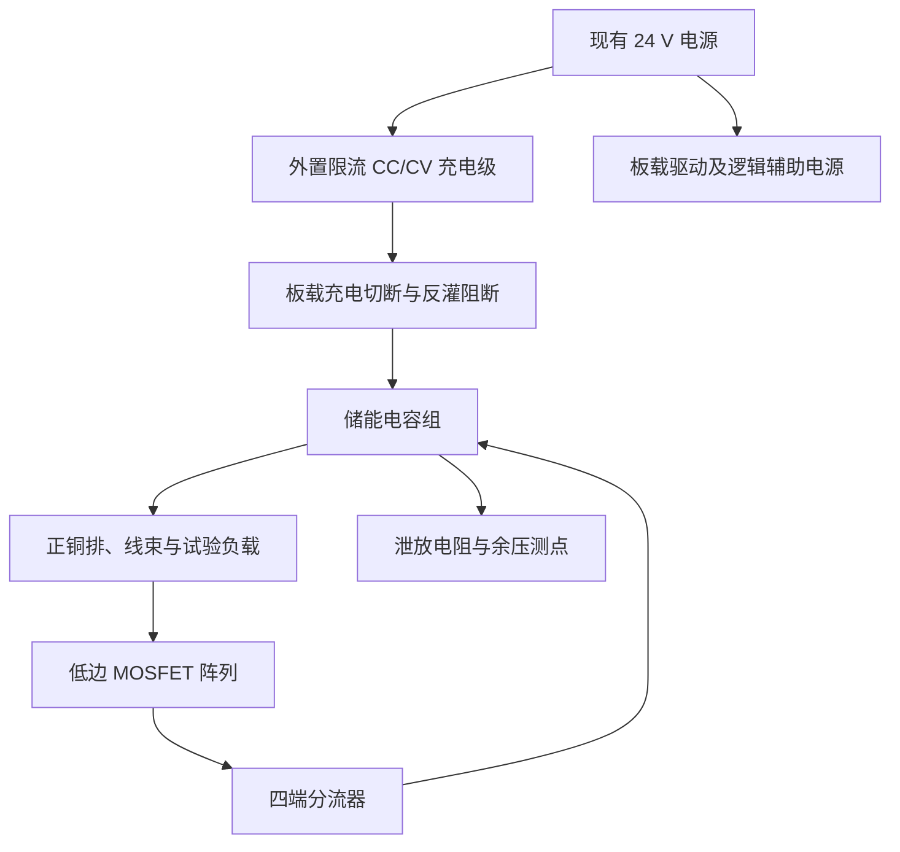
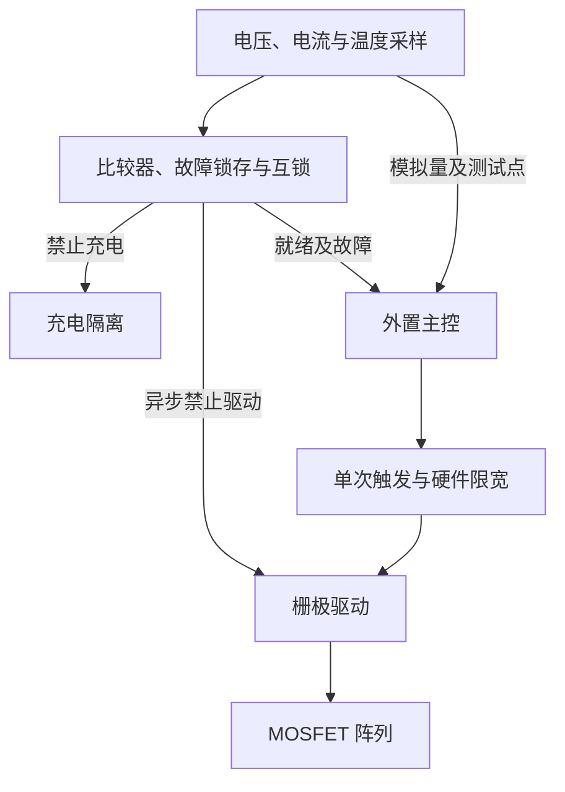

# SpotWelding 原型功率 PCB 架构设计

版本 v0.1 · 2026-11-25 · 原理图输入与评审稿

## 1. 范围与设计目标

复用现有 24 V / 42 A 成品电源、铜排、STM32 或 ESP 开发板及可选触摸屏。本阶段交付一块电容储能与 MOSFET 放电 PCB 的设计。首版验证可控充电、单脉冲、状态反馈、波形测量、故障关断与停机泄放。3000 A 保留为后续性能目标。原型范围以[技术方案第 0 节](technical-design.md)为准。

## 2. 电源和放电路径

首版采用外置充电级，功率板有独立的电容充电输入和辅助电源输入。正常放电时，充电级停止供能，板载充电支路切断。关断后，负载回路寄生电感通过靠近功率级的续流与钳位网络释放能量。负载回路正、负通路尽量相邻，并由铜排承担主要载流。

## 3. 控制和测量路径

| 模块 | 职责 | 边界 |
| --- | --- | --- |
| 外置主控 | 设置焊接脉宽、发出充电和焊接请求、采集状态 | STM32 作为设计基线，ESP 复用同一电平接口。触摸屏由外置主控接入。 |
| 功率 PCB 硬件逻辑 | 判断充电隔离和电压窗口，限制单次导通时间，锁存过流或过压 | 即使主控复位、停止响应或触发保持有效，板上依然能关闭驱动。 |
| 储能与放电 | 充电通断、储能、短脉冲放电、关断续流及停机泄放 | 电容储能和测试回路共同限制首轮放电应力。 |
| 测量 | 电容电压、电流波形和温度反馈 | ADC 及示波器用于记录，硬件过流和过压通路直接参与保护。 |

## 4. 运行状态

| 状态 | 充电支路 | MOSFET | 进入和退出 |
| --- | --- | --- | --- |
| 待机 | 断开 | 关闭 | 上电后等待电源稳定、触发回低和明确使能。 |
| 充电 | 接通 | 关闭 | 所有电源和保护状态正常时接受充电请求。达到设置电压后切断充电。 |
| 就绪 | 断开 | 关闭 | 确认充电隔离、电容电压在窗口内、驱动电源有效。接受一次新触发。 |
| 放电 | 断开 | 按硬件窗口导通 | 主控撤销触发、硬件窗口超时或故障任一出现即关闭。 |
| 冷却 | 断开 | 关闭 | 等待电感电流衰减、冷却时间和触发回低，再允许下一次充电。 |
| 故障 | 断开 | 关闭 | 硬件锁存，故障消除且使能与触发均撤销后才允许人工复位。 |

停电时驱动禁止，电容经独立泄放路径放电。MOSFET 漏源短路时栅极关断无法中断电容经负载释放的能量，因此首版采用限制储能、固定负载和防护工装。升档前须重新验证故障能量及独立直流切断能力。

## 5. 设计基线

器件候选、信号定义、计算与调试判据详见[功率 PCB 详细设计](power-pcb-detailed-design.md)。
