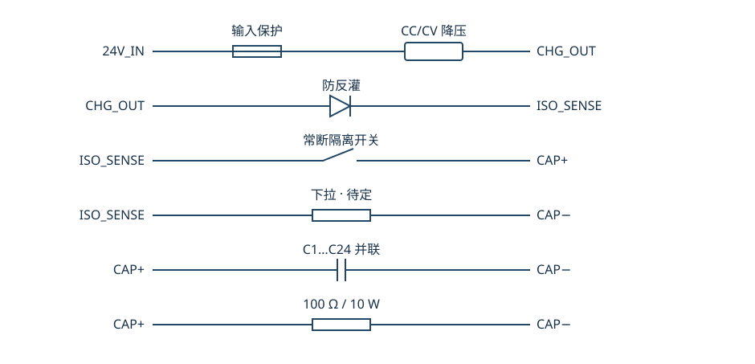
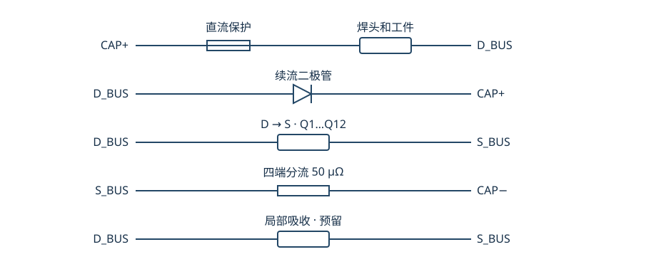
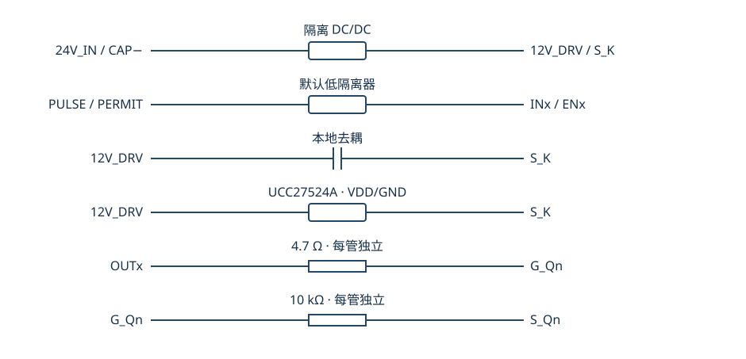
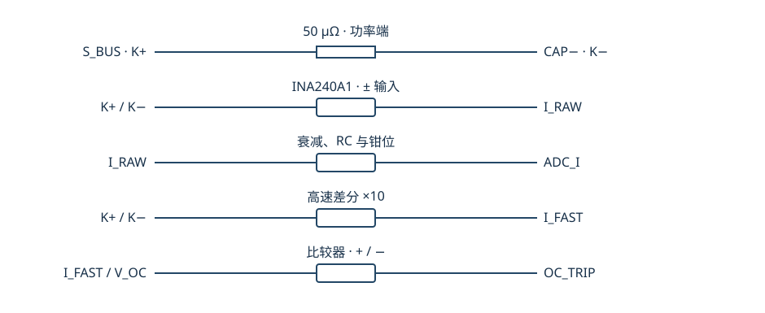
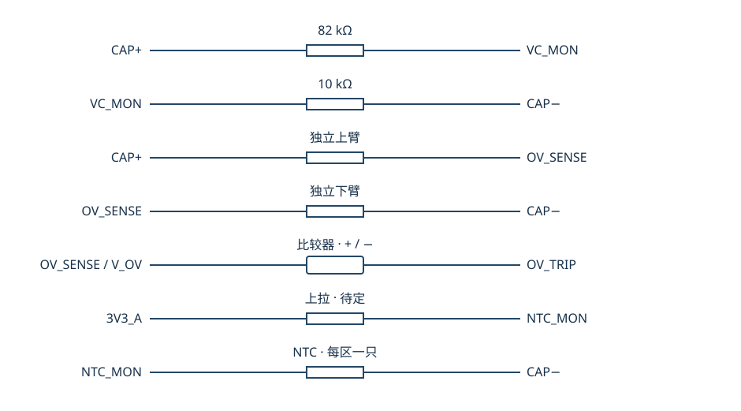
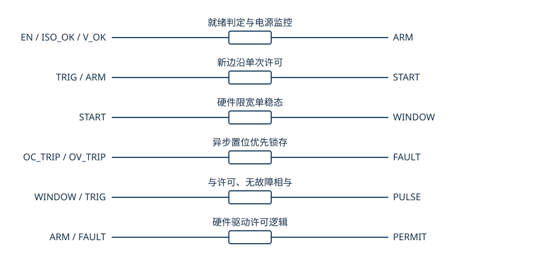
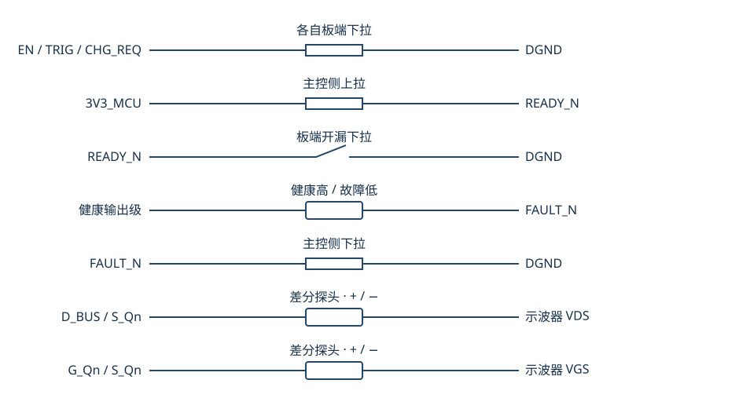

# 点焊功率组件详细设计
v0.5 · 2026-11-25 · 设计计算和候选物料，供工程验证

整板 A1 评审原理图覆盖充电与辅助电源、储能、放电、驱动、测量和硬件互锁。可下载[十页 PDF](../Hardware/PowerPCB/SpotWelding.pdf)，或打开 [KiCad 工程](../Hardware/PowerPCB/README.md)。

图中同名网络相连，斜线分列的端口各自接线。方框表示功能电路，阻容与二极管采用电气符号。生产原理图仍需确定封装引脚、保护阈值和器件额定值。

## 1. 电流和能量预算

**图 1　放电回路等效模型**

模型取导通期间的回路参数。R 包括焊头、工件和连接电阻。

24 × 10 mF 得 0.24 F。标称档按负载标定。新增设计验证电压候选上限 20 V，名义储能 48 J，比 16 V 时增加 56.25%。固定串联 RLC 模型以电容初压 16 V、电流初值 0、导通 2 ms 计算。按 L·di/dt = Vc − iR、C·dVc/dt = −i 积分得到下表。R 包含电容、MOSFET、分流器、铜排、焊头和工件。

| C | R | L | 峰值 | 2 ms 电流 | 导通释放电荷 |
| --- | --- | --- | ---: | ---: | ---: |
| 0.240 F | 4.0 mΩ | 0.20 µH | 3550 A | 496 A | 3.39 C |
| 0.192 F | 4.5 mΩ | 0.30 µH | 3049 A | 341 A | 2.80 C |

相同 R/L/C 下峰值随初压线性变化。要达到 3750 A，两行工况的电容端初压分别约为 16.90 V、19.68 V。20 V 下分别约 4438 A、3811 A，后一工况仅比设计目标高约 1.6%。20 V 仅用于充电级能力预算，逐点按实测负载定压，校核低阻负载的预测峰值、容差、过冲和故障能量后才允许升档。实际 3000 A 档按工装标定充电电压。将 4.5 mΩ 初步分给电容组 1.0、热态 MOS 阵列 0.6、分流器 0.05、铜排与连接 0.65、焊接线束及负载 2.2 mΩ。以脉冲阻抗实测逐项核销。组 ESR ≤1 mΩ 对等流的 24 颗并联对应单颗 ≤24 mΩ。连接寄生和批次离散另计。温度、负载、电压误差及寿命末期须覆盖；边界不够先改回路或重新配容并更新成本。

## 2. 主回路与充电

**图 2　充电、隔离与泄放**

降压级和隔离开关分别接受硬件禁用。诊断读取 CHG_OUT 与 ISO_SENSE。

电容候选见[技术方案成本表](technical-design.md)。设计峰值 3750 A 时平均每颗 156.25 A，偏流支路更高。对电容供应商提交波形、重复周期和环境温度，核实引脚和内部连接脉冲耐量。按每周期电流平方积分计算 RMS 和 ESR 发热，将容量下降、ESR 上升及外观列为寿命判据。

**图 3　焊接电流与续流路径**

Q1…Q12 漏极共接 D_BUS，源极共接 S_BUS。续流管阳极在 D_BUS。

充电级按 24 V 输入、最高 20 V 电容端候选、8 A 恒流设计。模型第一行升至 20 V 时放出约 4.24 C，理想补电约 0.53 s，需实测恒压尾段、关断和冷却后的完整节拍。正极依次串防反灌二极管、低电流侧常断隔离开关和 CAP+。两者之间设下拉和电压测点。禁用充电器后，只有充电器输出与隔离测点均降至低窗且电容仍在目标窗才接受放电。独立过压比较器同时禁用充电器及隔离开关。泄放起点 100 Ω / 10 W，20 V 时 4 W，标称电容从 20 V 到 1 V 约 72 s，容差上限、温升及故障输入另核。设计保留直流熔断、绝缘罩及余压测点，按实际短路电流和时间－电流曲线校核选择性。

## 3. 功率管与驱动

**图 4　栅极驱动及隔离供电**

每路 OUTx 分三支，分别到三颗 MOS 的 G。S_K 从本组源极近端取样。INx、ENx 外接下拉至 S_K。

四组、每组三颗 N 沟道低边 MOS。国产 NCEP01T15（100 V，10 V 栅压下标示 3.8 mΩ）作为可询价对照。12 颗理想冷态并联约 0.32 mΩ，3750 A 均分为 312.5 A/颗，必须代入实测偏流及最高结温核算。核对器件端波形、脉冲 SOA、封装和热态最差支路后批准料号。两片 UCC27524A，每通道三颗，各栅暂取 4.7 Ω 串阻、10 kΩ 栅源下拉，示波调整。以每组总 Qg/允许转换时间核驱动能力。驱动 IN、EN 外设默认低，12 V 驱动电源按合格栅压设置欠压关断。驱动回流在源极取 Kelvin，隔离驱动电源及默认低数字隔离覆盖外部 USB 接地与地弹风险。漏极至 CAP+ 配续流器件（阳极接漏极），并预留局部吸收。按 0.30 µH、3750 A 约 2.11 J 校核关断能量，故障峰值另算。[MOS 候选](https://item.szlcsc.com/217677.html) · [驱动器](https://www.ti.com/product/UCC27524A)

## 4. 采样与硬件关断

**图 5　分流器取样与硬件过流**

两路各自从分流器 Kelvin 端引线。INA240 用 5 V，REF1/2 接模拟地。V_OC 由保护预算定值。

- **电流。** 50 µΩ 四端低感分流器，3750 A 产生 187.5 mV，20 倍记录输出约 3.75 V（零偏置）。记录通路选 20 倍 INA240A1，5 V 供电，经衰减和限幅送开发板 ADC，按 0–4500 A 预留量程并校核饱和边界。保护通路由独立 Kelvin 走线、10 倍高速差分前端和比较器组成，3750 A 对应 1.875 V。按实际输入共模、地弹、输入失调和带宽选前端。设定点须同时覆盖正常峰值上偏差及最坏关断能力。整链延迟乘最大 di/dt 计入过流余量；用实测判定。独立电流探头测续流。[记录放大器](https://www.ti.com/product/INA240) · [比较器候选](https://www.ti.com/product/TLV3201)
**图 6　储能电压、过压及温度测量**

VC_MON 经 ADC 输入保护送主控；电容区、功率区各复制一组 NTC 分压。V_OV 使用独立基准。

- **电压、温度。** CAP 端 Kelvin 分压 82 kΩ / 10 kΩ，20 V 对应 2.17 V。过压保护使用独立分压、基准及锁存，阈值按最高工作点、误差和故障容限确定。电容与 MOS 热点各布一只 NTC，开短路禁止充放电。
**图 7　触发、限宽和故障锁存**

ARM 在接受触发时锁存本次许可。欠压、撤销使能及故障优先关断。故障同时禁止充电，复位须触发回低。

- **限宽和互锁。** 使能后仅接受新触发沿，每个硬件窗口只可触发一次。可用边沿锁存配单稳态阻断连续重触发。超时最小值须允许 2 ms 指令，最大值须在器件验证过的应力包络内。实测主控掉电、卡高、触发抖动、下电再上电和驱动欠压。故障优先于复位。
- **接口。** EN、TRIG、CHG_REQ 板侧下拉；READY_N 用开漏并由主控上拉，FAULT_N 健康时主动高、主控侧下拉。模拟与逻辑地接 CAP− 感测点，禁止形成绕过分流器的功率回路。

## 5. 可制造性、试验与生产检验

**图 8　主控接口与验证测点**

DGND 在 CAP− 感测点取参考。记录 I_RAW、OC_TRIP、PULSE，并用独立电流探头测负载续流。

铜排分别对称汇流四组 MOS 与电容支路，控制过孔和接点阻抗。建立电容极性防错、焊脚润湿检查、压接及扭矩规范。电容与功率管按批次追溯。用四线法记录关键连接电阻，脉冲实测整环 R/L，记录四组动态均流和器件端 VGS/VDS。替代料须用同一负载重做温升、关断和寿命验证。

先用 2 V、50 mΩ 和 100 µs 低能量台架检查极性和驱动，再逐档验证。对标称档建议室温参考负载峰值 3000 A ±5%、2 ms 指令误差 ±5% 作为待批准指标；用独立校准探头确认量测不确定度。设计验证另在约定的容量低限、回路阻抗上限和温度条件下验证可达 3750 A，计入测量不确定度，记录最差支路、热态 SOA、关断过冲及保护延迟。正常运行仍以 3000 A 档验证重复节拍与寿命。DVT 覆盖最低与最高负载、冷/热态、持续节拍、线束变化、开关短路、充电隔离失效和实物焊点拉脱。记录峰值之外的电流平方积分和焊点结果，避免仅用峰值放行。对假负载额定脉冲功率、连接防护和工装温漂进行单独确认。

每台终检记录序列号、物料批次、软件版本、校准系数、充电截止、充电隔离、故障注入、硬件最大脉宽、泄放时间及参考负载脉冲。控制限由 DVT 和量测系统验证冻结。试产保留返修分类、测试工时、良率与各项实付成本。板图、采购 BOM、产测夹具和型式试验记录在工程阶段形成，批准后转入批量制造。
