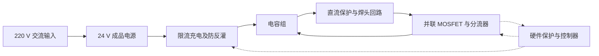

# 3000 A 晶体管式点焊电源技术方案

版本 v0.1 · 2026-11-25 · 样机设计评审稿

## 0. 当前阶段范围｜低成本功率 PCB 原型

本阶段设计并验证一块电容储能、MOSFET 放电的功率 PCB。先用现有设备跑通限流充电、电容电压监测、受控放电和故障关断，再依据实测波形和温升决定下一轮峰值电流目标。第 1 至 7 节保留为前期整机方案参考，其中的 3000 A、原电源型号、电容与 MOSFET 数量、整机成本及量产测试要求暂不作为首版 PCB 的选型或验收依据。

| 现有设备 | 原型中的用途 |
| --- | --- |
| STM32 和 ESP 开发板 | 暂用一块开发板作为外置主控，负责触发、参数设置和状态读取。原型接口先约定触发、使能、就绪与故障信号，具体板型、电平、引脚和接地在原理图评审前确定。 |
| 触摸屏 | 可接外置主控用于显示和设置。首轮功率板可以独立于触摸屏调试。 |
| 24 V / 42 A 成品开关电源 | 作为充电侧上游电源。电容充电电压和限流值独立确定，充电级放在板上或外置均可，以首版成本和现有模块条件决定。 |
| 现有铜排 | 用于电容组、MOSFET 功率级和焊接回路之间的大电流连接。PCB 设计需匹配铜排尺寸、孔距、连接位置和机械固定方式。 |

**功率板设计范围。** 包含储能电容组、并联 MOSFET 功率级及栅极驱动、铜排端子、储能电压与放电电流测量、停机泄放及故障反馈。板端须定义触发默认关闭、独立最大导通时间和过流关断。充电路径须有受控限流及防反灌措施，并验证放电期间的充电互锁。原型暂不开发专用主控板、触摸屏控制板或整机结构。

**首轮交付与验证。** 交付原理图、PCB 布局和样机 BOM。先用已知脉冲负载进行受限能量测试，检查充电、单次和重复触发、复位或断开控制后禁止触发、故障关断和停机泄放，记录电容电压、放电电流、MOSFET 端电压及温升。根据测试结果确定提高储能与放电电流的条件。下板前需确认现有电源型号、铜排尺寸及孔位，以及首轮测试负载、目标脉宽和电容充电电压范围。

## 1. 产品定义

面向电池极耳与薄金属件的电阻点焊，采用 220 V 交流输入、成品开关电源限流充电、电容储能、并联 MOSFET 直接放电。首版在规定假负载和线束下，以 3000 A 峰值、2 ms MOSFET 导通指令、约 1 次/秒为开发目标。实测电流脉宽、峰值允许误差、连续点焊时间、适用材料与厚度、焊点拉脱力及电极压力窗口，均在工艺试验后定版。面向中国大陆组装及销售，整机初版按手动焊头配置估算。

## 2. 系统架构

主回路为电容正极经直流保护件、焊头与工件、低边 MOSFET 阵列及四端分流器返回电容负极。充电支路在焊接前停止充电并隔离，隔离开关失效及反灌阻断能力应在设计评审中验证。市电区、储能与功率区、低压控制区分区布置。金属机箱及适用的外露导电件接保护地，主回路与保护地的连接策略随绝缘设计和 EMC 验证定版。

## 3. 第一版参数与选型

| 模块 | 设计起点 | 选型和验证条件 |
| --- | --- | --- |
| 成品开关电源 | Mean Well LRS-350-24，24 V / 14.6 A | 上游按 220 V AC 配置输入档位。由后级控制充电电流，核对空电容启动、供电瞬态和温升。[数据手册](https://www.meanwell.com/Upload/PDF/LRS-350/LRS-350-SPEC-CN.PDF) |
| 充电级 | 10 A CC/CV 降压，工作电压上限暂取 14 V | 确认可从 0 V 启动，支持充电使能、输出防反灌及焊接期间隔离。独立过压保护阈值按误差预算及器件边界定版。 |
| 电容组 | 16 × 68,000 µF / 25 V 并联，名义 1.088 F。TDK B41456B5689M600 为参考件 | 围绕组级等效串联电阻 ESR、低温与老化偏差、约 188 A/颗平均分流下的瞬时峰值，以及实际支路余量和重复寿命确认量产型号。数据表的纹波电流条件与本机脉冲工况不同，需供应商确认或做寿命试验。[电容数据手册](https://www.tdk-electronics.tdk.com/inf/20/30/db/aec/B41456_B41458.pdf) |
| 功率开关 | 16 × IPT015N10N5，分为 4 组，每组 4 颗。100 V，10 V 栅压时单颗导通电阻最大 1.5 mΩ | 名义每颗 188 A。按最差支路电流、热态导通电阻、瞬态结温、开关过程 SOA、封装及铜排连接能力校核。[器件资料](https://www.infineon.com/part/IPT015N10N5) |
| 栅极驱动 | 2 × UCC27524A，四路，每路驱动一组，12 V 供电。每颗独立栅阻，4.7 Ω 为调试起点 | 组内尽量对称，驱动回流接各组源极附近，驱动去耦就近布置。以实测门极振铃、关断过冲和支路均流确定阻值。[驱动器资料](https://www.ti.com/product/UCC27524A) · [MOSFET 并联布局](https://www.infineon.com/assets/row/public/documents/24/42/infineon-optimizing-layout-for-paralleling-power-discrete-semiconductor-devices-applicationnotes-en.pdf) |
| 电流采样 | 50 µΩ 低感四端分流器，3000 A 对应 150 mV | 分设硬件过流通道和波形记录通道，校核电感尖峰、带宽、脉冲能量、温漂和采样延迟。电极电压另用独立差分采样线测量。 |
| 续流与钳位 | 漏极汇流点至电容正母线布置续流回路，二极管阳极接漏极汇流点，阴极接正母线 | 按正常及故障关断的峰值电流、能量、重复频率和回路寄生电感选型。按器件端实测过压决定局部钳位或吸收电路。 |

## 4. 放电与热设计估算

名义模型采用串联 RLC，电容 1.088 F、电容预充 11.04 V、总回路电阻 3.5 mΩ、总寄生电感 0.20 µH。总电阻包含电容 ESR、MOSFET、分流器、线束、电极及工件等。模型假定 R 和 L 固定，用于建立测试基线。

| 计算情形 | 结果 |
| --- | --- |
| 名义工况 | 约 0.246 ms 达到 3000 A，2 ms 关断前约 1910 A |
| 总电阻降至 2.0 mΩ，其余条件相同 | 理论峰值约 4950 A，实际由保护、器件及负载限制 |
| 名义工况导通 2 ms | 导通期间放出约 4.85 C，10 A 理想补电约 0.49 s，完整周期另计续流、控制与充电稳定时间 |
| 14 V 上限的电容组储能 | 名义约 107 J，按电容上偏差校核故障能量 |
| 3000 A 时回路电感储能 | 约 0.9 J，保护校核应代入最差电流及电感 |

电流调节通过预充电压与导通时间实现。记录峰值、电流波形和电极端能量积分，并以规定线束、参考负载和温度条件定义峰值标称值。若工艺试验证明需要 2 ms 的 3000 A 平顶电流，需重新评估带续流电感的闭环斩波方案。

## 5. 控制顺序和故障响应

上电自检 → 充电 → 电压进入窗口 → 充电隔离确认 → 焊头压紧和触发判定 → 放电脉冲 → 记录波形和故障状态 → 冷却或补电。每次脉冲后重新判断触发许可。掉电、复位、看门狗异常、驱动欠压或触发线路异常时，栅极驱动进入默认关闭。故障锁存后须解除触发、确认故障消失并人工复位。

| 故障 | 独立保护与确认方式 |
| --- | --- |
| 工件短路、峰值超限或控制器输出持续有效 | 硬件比较器直接锁存关断，另设独立最大脉宽限制。用实测延迟及电流上升率核对最坏关断电流。 |
| MOSFET 漏源短路 | 关断充电，评审独立直流隔离与短路保护。用实测故障波形及器件时间－电流曲线证明正常脉冲可通过、故障可切断，并评估储能在保护动作前的释放。 |
| 电容过压、充电反灌或充电开关粘连 | 独立硬件过压切断，核对故障电流路径和器件反向耐压。停机配置泄放与剩余电压指示，并验证泄放时间。 |
| 过温或传感器开短路 | 监测电容组及功率级温度，异常时抑制触发与充电，故障状态可识别。 |

## 6. 样机验证与量产交付

| 阶段 | 试验内容 | 交付证据 |
| --- | --- | --- |
| 充电和小能量调试 | 空电容启动、限流、充电隔离、过压与掉电泄放。使用已知毫欧级脉冲假负载，从低电压和短导通逐步升档。 | 充电及泄放波形、实际 R/L、保护动作时间 |
| 满目标脉冲 | 测总电流、四组支路、MOSFET 端 VDS/VGS、电极电压。覆盖负载变化、热态、过流关断和重复脉冲。 | 峰值统计、均流与器件应力记录、持续运行温升 |
| 工艺确认 | 对目标极耳和基材按厚度、电极压力及脉冲参数做试验，评估焊点外观、拉脱力及重复性。 | 工艺窗口、产品适用范围、焊点检验标准 |
| 小批试产 | 供应商批次验证、电容脉冲寿命、整机安规及 EMC 评估。建立序列号与关键物料批次追溯。 | 冻结 BOM、装配工艺、出厂检验规范、试验报告、铭牌和中文说明书 |

## 7. 国内组装成本及上市依据

单台零散采购估算为电源本体约 ¥6,900–8,100，配简易手持焊头约 ¥7,200–8,700。沿用进口参考件时，16 颗 TDK 电容单项约 ¥4,328。若以含税直售价 ¥6,999 和 35% 产品毛利测算，按一般纳税人 13% 税率的未税制造成本上限约 ¥4,026。其余整机成本若能控制在 ¥2,200，电容组采购目标约 ¥1,826，按 16 颗折合约 ¥114/颗。单台报价与批量目标分开管理，后者需供应商报价、样品验证及小批试产支持。[电容采购参考](https://www.digikey.cn/zh/products/detail/tdk/B41456B5689M600/26860354) · [增值税法](https://shanghai.chinatax.gov.cn/zcfw/zcfgk/zzs/202412/t474694.html)

中国大陆销售按电阻点焊整机立项，电阻焊机原 CCC 类别 0611 已退出强制认证管理。若另售独立电源模块，按最终配置单独确认分类。GB 15578-2008 为本稿编制日的现行安全标准，GB 15578-2026 自 2027-02-01 实施，按预计上市日期安排整机试验。与实验室确认 GB/T 31251.2-2014 的适用项目及出厂检验要求。[CCC 调整公告](https://www.cnca.gov.cn/zwxx/gg/2019/art/2023/art_e58d62951390415ebcc22a83577e2c37.html) · [现行安全标准](https://openstd.samr.gov.cn/bzgk/std/newGbInfo?hcno=11D843BACB058DD5AB4F4C9238C6B835) · [新版安全标准](https://openstd.samr.gov.cn/bzgk/std/newGbInfo?hcno=5D2C26C09BF8F165C13A86E269F19A66) · [EMC 标准](https://openstd.samr.gov.cn/bzgk/std/newGbInfo?hcno=C53D11A5A5CFDC6EB3B3670AE38F9A2F)
